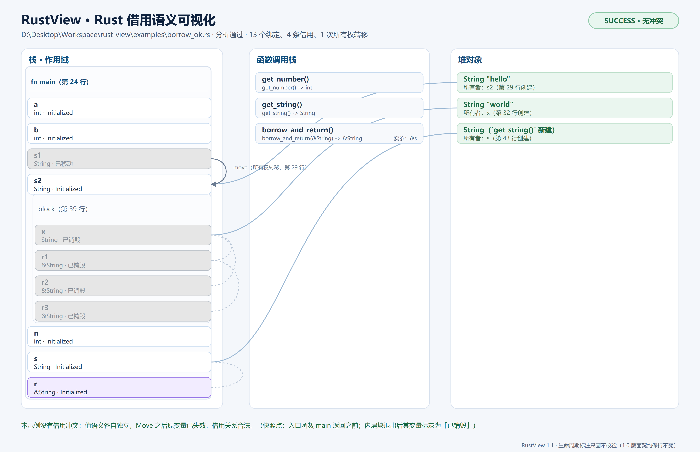
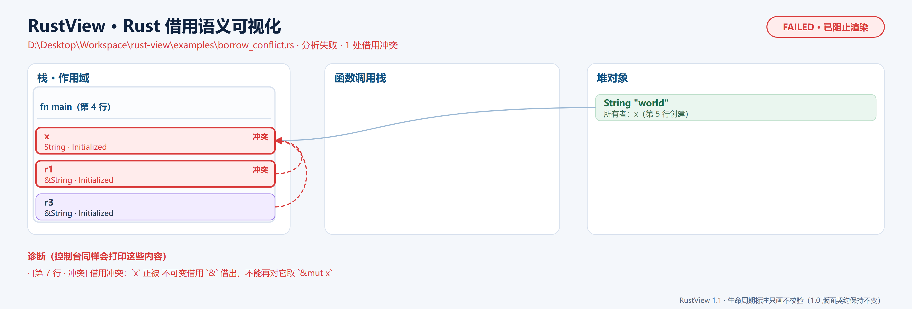
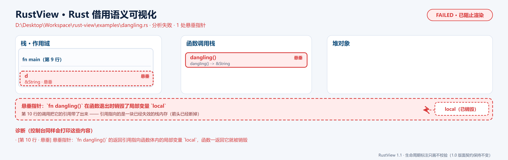
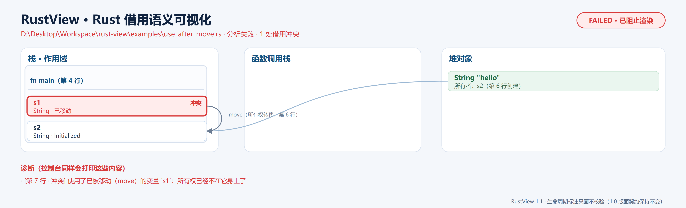

# RustView

RustView 把一段**极简 Rust 伪代码**画成一张 **SVG 图**和一个 **HTML 展示页**，让不懂 Rust 的人一眼看懂**值语义**、**移动（Move）**、**借用（`&` / `&mut`）**、**块作用域**、**借用冲突**、**悬垂指针**和**生命周期标注的读法**。

整个工具零第三方依赖：图表是标准库字符串拼出来的 SVG，前端由外部的解析器生成器
**ParseEngine** 从 [rust_subset.gram](rust_subset.gram) 生成（`cpp17` 后端 + `ielr` 模式），
`src/` 里**没有手写的 lexer / parser**。文法共 **24 个 Token、53 条产生式**，生成报告显示
**97 个 IELR 状态、0 个未消解冲突**。

> 本工程是**独立仓库** <https://gitee.com/rabbitc999/rust-view>（早期在 ParseEngine 仓库里
> 长大，现与 Magel、MetroLang、Hydra86、CAS 同例拆出）。生成器 ParseEngine 是外部依赖：
> 本仓库只含 `.gram`，构建时自动找旁边的 ParseEngine 仓库（见下）。



> 上面这张图由 `examples/borrow_ok.rs` 生成。点开看可交互的单文件演示页：
> [**doc/preview.html**](doc/preview.html)（自包含，离线可看）。项目结构总览图在
> [doc/overview/RustView-overview.png](doc/overview/RustView-overview.png)
> （`make overview` 重生成）。

## 版本与冻结

当前版本 **1.1.0**（见 [`VERSION`](VERSION)）。1.0 曾做功能冻结；1.1 按需求解冻，
加入了**生命周期标注的解析与画图**（只画不校验），其余 1.0 契约（语言边界、借用分析
规则、退出码约定与图表版面）保持不变。变更记录见 [`CHANGELOG.md`](CHANGELOG.md)。

## 快速开始

在本仓库根目录执行（生成器 ParseEngine 是外部依赖，默认从旁边的 ParseEngine 仓库找；
找不到可 `make PARSER=/path/to/ParseEngine.exe`）：

```sh
make             # 生成 C++17 前端并编译出 build/rust-view/rust-view（Windows 上带 .exe）
make check       # 跑 6 组样例：正常 / 三种报错 / 不支持的语法 / 生命周期标注
```

跑一个自己的文件：

```sh
./build/rust-view/rust-view examples/borrow_ok.rs -o /tmp/out
# Windows：./build/rust-view/rust-view.exe examples/borrow_ok.rs -o /tmp/out
# 输出：/tmp/out/borrow_ok.svg、/tmp/out/index.html（另存一份 /tmp/out/borrow_ok.html）
```

命令行参数：

| 参数 | 含义 |
| --- | --- |
| `<源码.rs>` | 必填，要分析的极简 Rust 伪代码 |
| `-o, --out <目录>` | 输出目录（不存在会自动创建），默认当前目录 |
| `--name <基名>` | 输出文件基名（默认取输入文件名去扩展名），产出 `<基名>.svg` / `.html` |
| `-h, --help` | 用法 |

退出码（方便脚本 / CI 判断）：

| 退出码 | 含义 | 有没有产物 |
| --- | --- | --- |
| `0` | 分析通过，无任何诊断 | 有 SVG / HTML |
| `1` | 语法错误、生命周期标注写错、或有借用冲突 / 悬垂指针 / 使用了已移动的变量 | 语法错误与生命周期错误：**无**；借用问题：**有诊断图**（冲突标红） |
| `2` | 出现了**本工具不支持的结构**（如字段级访问 `s.a`） | **绝不生成任何文件** |

## 语言范围（刻意锁死）

| 特性 | 支持情况 | 说明 |
| --- | --- | --- |
| 值语义 `int` | ✅ | 赋值是**拷贝**，画两个独立节点，互不影响 |
| 引用语义 `String` | ✅ | 赋值是**Move**，原变量变灰、标「已移动」 |
| 借用 `&T` / `&mut T` | ✅ | 只支持 `&变量` / `&mut 变量` 这种**整体借用** |
| 引用的引用 `&r` | ✅ | 简化模型按「再借一层」处理，共享借用可共存 |
| 块作用域 `{ }` | ✅ | 可嵌套；出块自动清理变量与借用状态 |
| 函数 | ✅（签名黑盒） | 只解析签名与函数体局部变量；调用点按签名处理，不展开函数体 |
| 生命周期标注 | ✅ **只画不校验** | `fn f<'a>` / `&'a T` / `&'a mut T`；图上多一栏「生命周期」解释 `'a` 绑到谁，**不做**合法性校验 |
| 结构体 | ⚠️ 仅整体 | 只支持整体移动 / 整体借用 |
| 字段级访问 `s.a` | ❌ **硬失败** | 属于「部分移动 / 字段借用」，报错并**不生成任何图** |
| 泛型 `<T>` / trait / 宏 / async | ❌ | 文法直接不认，报语法错误 |
| `for` / `while` / `if` / `match` / `return` / 赋值语句 | ❌ | 同上 |
| `print(expr);` | ✅ | 只当「用这个值一次」，用来暴露「打印已 move 的变量」这类错误 |

## 示例

| 样例 | 期望结果 | 诊断图 |
| --- | --- | --- |
| [`examples/borrow_ok.rs`](examples/borrow_ok.rs) | 分析通过，退出码 0 | [PNG](doc/preview.png) · [HTML](doc/preview.html) |
| [`examples/borrow_conflict.rs`](examples/borrow_conflict.rs) | `&` 还活着时又取 `&mut` → 报错，退出码 1 | [PNG](doc/preview-conflict.png) · [HTML](doc/preview-conflict.html) |
| [`examples/dangling.rs`](examples/dangling.rs) | 返回局部变量的引用 → 悬垂，退出码 1 | [PNG](doc/preview-dangling.png) · [HTML](doc/preview-dangling.html) |
| [`examples/use_after_move.rs`](examples/use_after_move.rs) | 读一个已被 move 的变量 → 报错，退出码 1 | [PNG](doc/preview-use-after-move.png) · [HTML](doc/preview-use-after-move.html) |
| [`examples/lifetime.rs`](examples/lifetime.rs) | 生命周期标注 `'a` 的读法演示 → 分析通过，退出码 0，图上多一栏「生命周期」 | [PNG](doc/preview-lifetime.png) · [HTML](doc/preview-lifetime.html) |
| [`examples/unsupported_field.rs`](examples/unsupported_field.rs) | 字段级访问 `s.a` → 硬失败，退出码 2，**不写文件** | —— |

三种典型诊断图：

| 借用冲突 | 悬垂指针 | move 后使用 |
| --- | --- | --- |
|  |  |  |

重新生成 `doc/` 里的效果图与演示页：

```sh
make preview                    # PNG 默认 3 倍（1320 画布 -> 3960px，缩放看不糊）
make preview PREVIEW_SCALE=4    # 想要更清晰就调高倍率
```

## 怎么做到「不用手写 lexer / parser」

### 1. 文法：`rust_subset.gram` 是这门语言的唯一语法定义

关键字**逐个登记**成 Token，标点、字符串、数字、标识符各走各的规则，注释走 `%trivia`：

```text
%trivia "//[^\n]*"
%token regex STRING "\"([^\"\\\\]|\\\\.)*\""
%identifier "[A-Za-z_][A-Za-z0-9_]*"
%token KW_FN "fn"        %token KW_LET "let"   %token KW_MUT "mut"
%token ARROW "->"        %token AMP "&"        %token LBRACE "{"     ...
```

文档 / 函数 / 结构体 / 块 / 语句 / 表达式 / 类型 / 列表**全是显式产生式**，块结构与尾表达式在
产生式里点名：

```text
fn_def  := KW_FN VARIABLE LPAREN param_list RPAREN fn_return block { $$ = rv_fn($2, $4, $6, $7); }
block   := LBRACE stmt_list RBRACE           { $$ = rv_block($2, rv_none()); }
block   := LBRACE stmt_list tail_expr RBRACE { $$ = rv_block($2, $3); }
expr    := AMP KW_MUT VARIABLE               { $$ = rv_borrow($3, 1); }
```

语义动作只调用 `%code`（`include/rust_syntax.hpp`）里声明的 `rv_*`，这些函数的实现内嵌在
`%epilogue`（`epilogue/rust_parse.cpp`）里，随生成产物一起编译——所以**建树逻辑也在生成器流程内**。

### 2. 生成前端

```sh
../ParseEngine/build/bin/ParseEngine rust_subset.gram --lang cpp17 --mode ielr --out-dir build/rust-view/gen
```

产物：`parser.hpp` / `parser.cpp` / `parser_user.h`（`%code` 内嵌区）/ `RESULT.md`（生成报告，
当前**无未消解冲突**）。

### 3. `main.cpp` 只调用生成出来的接口

```cpp
// 语法分析：交给 ParseEngine 生成的 Parser::Engine，绝不手写解析驱动。
rustview::NodePtr program;
std::vector<std::string> parseErrors;
if (!rustview::parseText(source, program, parseErrors)) { /* 打印错误、退出，不写文件 */ }

// 借用分析：作用域栈 + 借用状态表。
rustview::Analyzer analyzer(*program);
const rustview::AnalysisResult result = analyzer.run();

// 图表：手写字符串拼 SVG + 包一层自包含 HTML。
rustview::Visualizer visualizer(result, options);
const std::string svg  = visualizer.renderSvg();
const std::string html = visualizer.renderHtml(svg);
```

`parseText()` 内部调用 `Parser::Engine::runText(...)`，把生成的词法 / 语法分析器接上我们的 AST：

```cpp
Parser::Engine engine;
Parser::ParserValue_T root = -1;
if (engine.runText(normalized, &root) != Parser::Status::Ok) {
    for (const Parser::Error &e : engine.errors()) { /* 行列号 + 说明 + 上下文 */ }
}
```

Token 到语义值的转换由文法里的宏完成：

```cpp
#define PARSER_USER_TOKEN_VALUE(pToken) \
    (::rustview::rv_token_value((pToken)->text, (pToken)->value, (pToken)->line))
```

## 分析原理（这是看懂图的关键）

`Analyzer` 维护**两张表**：

- **作用域栈**：`{` 压栈、`}` 弹栈。每一帧记着「这一层里的名字 → 变量 id」，所以内层同名变量
  自然遮蔽外层，弹栈后又恢复。弹栈时做三件事——
  1. **清理借用状态**：把这一层引用变量借出去的占用还回去（否则「块里借一下、块外再 `&mut`」
     会被误报冲突）；
  2. **标记销毁** `destroyed = true`：整层一起标，避免同层的引用变量误报悬垂；
  3. **悬垂检测**：如果某个**外层**还活着的引用指向了刚被销毁的变量，就是「引用活过了被借对象」。
- **借用状态表**：每个变量有状态 `Uninitialized / Initialized / Moved / BorrowedImmutable /
  BorrowedMutable`，状态由「借用计数」推导（`refreshState()`），不是各分支各写一套。

`Analyzer` 判定的四类问题：

| 规则 | 触发条件 |
| --- | --- |
| 可变借用独占 | `&mut x` 期间，`x` 上还有任何借用（`&` 或 `&mut`）→ 冲突 |
| 读不能与写并存 | 已有 `&mut x` 时再取 `&x` → 冲突 |
| move 后不可用 | 变量 `state == Moved` 时再读 / 再借 → 冲突 |
| **悬垂指针** | 函数声明返回 `&T`，而函数体把**局部变量**的引用返回出去（或返回的引用绑不到任何传入参数）→ 冲突 |

### 生命周期标注（1.1 新增，只画不校验）

文法认识 `fn first<'a>(s: &'a String) -> &'a String` 这类写法：函数的泛型参数表
`<'a, 'b: 'a>`、类型里的 `&'a T` / `&'a mut T`（`&mut 'a T` 也认）。但**只解析、只画图，
不校验**——「返回的引用是否真的来自 `'a`」是借用检查器的事，本工具不做。

- 源码里出现标注时，图上会**多出第四栏「生命周期标注」**：上半截列出每个函数声明的
  参数表（`fn first<'a>`），下半截列出每个带标注的调用点——`'a` 被绑定到第几个实参上。
- 引用变量的类型文字会带上标注（`&'a String · Initialized`），和源码写法一致。
- 标注本身写错（`'a` 没在 `<...>` 里声明、重复声明、`'a: 'a` 自己约束自己）会报
  `[生命周期]` 错误，**不生成文件**，退出码 1。
- 不写标注的源码，图和 1.0 完全一样（版面冻结契约保持）。

> 图上快照点取「入口函数 `main` 返回之前」：函数自己那一层作用域这时还没拆，所以它的变量**不**
> 显示「已销毁」；只有**内层块**退出时被销毁的变量才标灰——那正是块作用域的教学点。

## 目录结构

```text
├── rust_subset.gram        # 权威文法：%token / 产生式 / %code 建树动作 / %epilogue
├── include/
│   ├── rust_ast.hpp        # AST：NodeKind + 单一 Node 结构 + 节点池下标句柄
│   ├── rust_syntax.hpp     # rv_* 建树动作声明、parseText()、Token→语义值宏
│   ├── analyzer.hpp        # Analyzer：作用域栈 + 借用状态表 + 诊断 + 生命周期注记
│   └── visualizer.hpp      # Visualizer：AnalysisResult -> SVG / HTML
├── src/
│   ├── main.cpp            # CLI：parseText -> Analyzer -> Visualizer -> 写文件
│   ├── analyzer.cpp        # 借用分析实现（含每处判断的「为什么」注释）
│   └── visualizer.cpp      # 纯字符串拼 SVG + HTML 包装（零依赖）
├── epilogue/rust_parse.cpp # 内嵌进生成产物的语义层（节点池 + rv_* + parseText 驱动）
├── VERSION                 # 版本号（当前 1.1.0：1.0 冻结 + 1.1 生命周期标注）
├── CHANGELOG.md            # 变更记录 / 冻结口径
├── examples/*.rs           # 6 组样例（正常 / 三类报错 / 不支持 / 生命周期标注）
├── doc/                    # README 用的效果图（svg/png）与演示页（html）
├── doc/overview/           # 项目总览图（make overview 重生成）
├── tools/make_preview.py   # 批量重生成 doc/ 效果图（cairosvg 或浏览器截图）
├── tools/make_overview.py  # 重生成项目总览图（底座在 tools/overview_canvas.py）
├── ci.sh                   # 发布门禁：make all → check → preview
├── AGENTS.md               # 代码编写要求与提交要求
├── .gitignore              # build/ 与外部生成器等不进版本库
└── Makefile                # gen / all / check / preview / clean
```

产物落在 `build/rust-view/`（`gen/` 是生成的前端，`obj/` 是目标文件，可执行文件是 `rust-view`；
Windows 上为 `rust-view.exe`）。

## 文档注释约定

核心类（`Analyzer`、`Visualizer`）都带 Doxygen 风格 `/** ... */` 类注释，说明职责与核心成员；
公开函数写清参数 / 返回值 / 失败行为；**作用域压弹栈、状态流转、悬垂触发条件**这些关键逻辑
都有行内注释解释「为什么这么写」。这份代码本身就是可以拿去教学的。

## 边界与已知取舍（刻意不做）

- **不追求真实 Rust 语义**：没有 `Drop` 顺序、没有 NLL；生命周期标注**只画不校验**，
  「返回的 `&'a` 是否真的来自 `'a` 形参」这类问题留给真正的借用检查器。
- **函数体不展开**：调用点是黑盒，只看签名（入参借用、返回引用）与函数体里的局部变量。
- **没有结构体字面量**：`struct` 只能声明，字段访问一律判为不支持（宁可不画，也不画错）。
- 中途失败**绝不会**留下半成品图表：不支持的结构连输出目录都不会创建。

## 许可证

MIT，见 [`LICENSE`](LICENSE)。第三方依赖：无，纯标准库。
